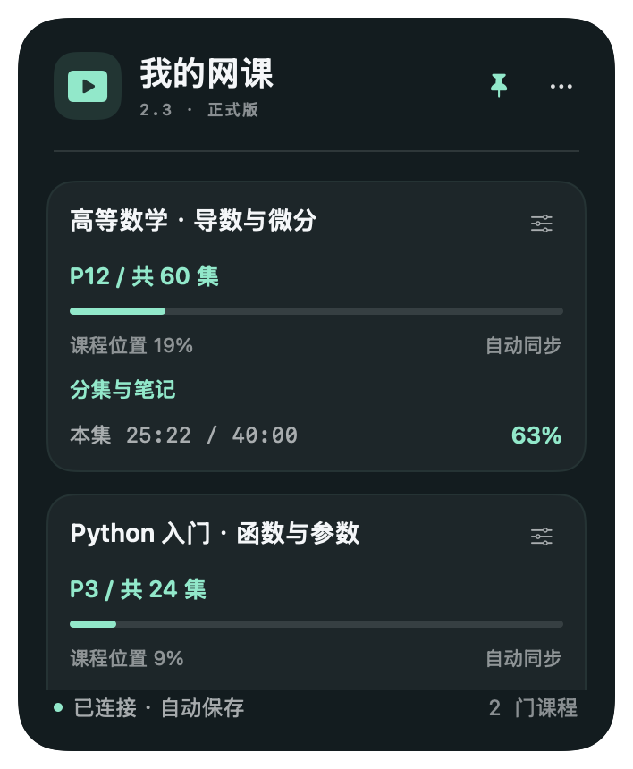

# 课点 · Kedot

**简体中文** | [English](README.en.md)

把网课进度放在桌面上，下一次学习从这里开始。



SwiftUI + AppKit 原生 Mac 悬浮窗，内置本机同步服务。支持 Apple Silicon、macOS 14+，Chrome 111+；日常运行无需 Python、Node.js 或 Xcode。它是独立窗口，不是系统 WidgetKit 小组件。

## 2.2.1 更新

拆分 SwiftUI 更新区域、缓存已选课程，避免相同数据重复触发列表更新；加固手动编辑滑杆边界，增加键盘焦点和 VoiceOver 提示，并适配“减少透明度”。见 [更新记录](CHANGELOG.md)。未测量实际帧率或耗电提升比例。

## 本版五项功能

### 1. 视频总进度
- 同一 BV 的多个分 P 合并成一门课程，显示例如 **P12 / 共60集**、课程位置进度、本集已看时间和百分比。
- 扩展从视频页公开的 `__INITIAL_STATE__.videoData.pages` 读取完整分集信息，不把浏览历史中最大的 P 数当成总集数。数据读取不到时显示“总集数待识别”，可手动补充。
- “课程位置”按 `(当前P−1＋本集播放比例) / 总集数` 计算，表示所在位置，不证明此前所有分集都完整看过。不同分 P 长度可能不同，不是总观看时长的加权比例。
- 跨 BV 的合集暂不合并。旧版已选择的同一 BV 分 P 会合并显示，原有各分 P 时间记录保留。

### 2. 跟随系统深浅色
- 卡片 `…` →“深浅色模式”，或“管理课程”→“外观模式”，可选“跟随系统 / 浅色 / 深色”。
- 六种主题色均适配浅色和深色；色彩与外观模式独立保存。跟随系统通过应用外观变化通知更新，不定时轮询。

### 3. 手动调整进度
- 点击卡片右上角的小滑杆图标，或管理窗口的“调整进度”。
- 可改当前 P、总集数、本集时长和已看秒数，也可用滑杆调整。只想改 P 数时，可将未知时长与已看时间都设为 0。
- 保存后该门课显示“手动记录”，暂停自动覆盖，防止被仍在播放的网页立即改回。
- 管理窗口点击“恢复自动”，或在卡片上右键 →“恢复自动同步”，即可继续跟随播放器。
- 手动修改只改变桌面记录，不会控制浏览器的播放头。总集数必须不小于当前 P，已看时间不能超过本集时长。

### 4. 可调节大小
- 拖动窗口右下角的斜向缩放标记，或窗口边缘调整大小。字体、按钮、间距会依据窗口宽高等比例适配，多余课程可滚动。
- 支持 282×310 至 850×1050 点；宽高可独立调整，内容等比缩放，避免字形变形。
- 拖动左上角图标/标题区域移动；窗口尺寸、位置、置顶与紧凑偏好均自动保存。

### 5. 更及时、省电的同步
- 改为播放器事件驱动，无每秒查找播放器的定时轮询。正常前台播放最多约每 2 秒发一次；后台约每 10 秒；系统低电量模式分别约 5/15 秒。
- 暂停、播放结束、跳转完成等事件会尝试立即同步并保存。暂停时的 timeupdate 不持续上传，重复相同位置会跳过。
- 本机界面收到请求即更新；播放中的连续数据最多每约 10 秒合并写盘，暂停/手动修改/正常退出/系统睡眠前会立即尝试保存。系统低电量模式关闭卡片背景模糊；窗口隐藏时减少课程列表重建。
- 离线失败后指数退避 5～60 秒，合并缓存最多50条最新记录；暂停等关键事件立即持久化缓存。恢复后重发最新记录，不逐条回放过期进度。
- 历史只在首次、手动请求或约30分钟间隔全量扫描；新访问的视频由历史事件实时发现。浏览器每5分钟进行兜底检查。
- 这些措施减少定时唤醒、重复传输和写盘；未测量电池续航提升百分比。

## 安装 / 升级

从 GitHub 获取源码时，请先按“开发与复测”构建 `BiliWidget.app`；源码 ZIP 不能直接作为应用运行。
1. 退出旧版。解压交付包，把新版 `BiliWidget.app` 拖入“应用程序”或固定位置，再打开。
2. 管理课程 →“显示扩展文件夹”。Chrome 打开 `chrome://extensions`，开启开发者模式，加载 `extension` 文件夹。建议先把 extension 复制到固定位置（例如“文稿/BiliWidgetExtension”），再加载；以后只替换这个固定目录中的文件。不要依赖会在升级后被清理的旧版本目录。
3. 已装旧扩展：用新版 `extension` 内容替换 Chrome 原来加载的文件夹，再点击“重新加载”，保留配对设置。若从新路径加载、扩展 ID 改变，则重新配对。只启用一份扩展。
4. 桌面程序“复制配对码” → Chrome 扩展选项页粘贴 →“保存并同步历史”。**刷新已经打开的 B站页面**，以启用新的播放器事件与分集采集脚本。
5. 在管理窗口选择课程。播放视频核对 P 数、总集数和本集时间；拖动窗口右下角测试缩放。

应用是 ARM64 本机临时签名，未做 Developer ID 签名和 Apple 公证；首次打开如被拦截，请在“系统设置 → 隐私与安全性”按系统提示允许本应用，不需要关闭系统安全功能。

## 数据与权限
- 沿用 `~/.bili_course_tracker/data.json`、`token.txt`，兼容旧版视频记录。新增 `courses` 保存每个 BV 的总集数、当前位置、课程选择和手动保护状态。
- 学习数据、配对码与个人偏好不随旧版安装包清理而删除。升级前建议自行备份整个数据目录。
- 仅监听 `127.0.0.1:8765`；Bearer 配对码、Host/Origin、请求体和数值校验继续保留。扩展权限仍为 history、alarms、storage 和原有 B站/本机 host 权限，无新增远端接口。
- 主世界脚本只读取页面的公开分集信息并通知隔离脚本，不访问配对码或 Chrome API；所有网页数据在本机接口再次校验。
- 不读取 Chrome Cookie、B站密码或云端账号历史，无云端上传。损坏的数据会报错并保留。

## 限制和故障排查
- 历史导入最多最新500条匹配项，不能还原安装扩展前的播放时间。支持 BV 地址及其分 P；直播、番剧、跨 BV 合集不属于本版范围。
- B站网页结构、播放器事件或全局状态变化可能影响识别，尤其单页导航、广告与特殊播放器；读取不到总集数可手动填入。真实 Chrome/B站完整验收仍需用户进行。
- 系统可能节流后台页面、冻结标签页或休眠机器，不能保证后台秒级更新。浏览器关闭或强制终止时最后几秒可能未发送；桌面应用被强制结束或突然断电时，合并写盘中最多约10秒的新进度可能丢失。
- 离线期间，后台缓存更新通常每15秒合并一次，暂停等关键事件立即缓存；浏览器在两次缓存之间被强制退出时，最后变化可能丢失。无新的播放事件时，恢复同步最多等待约5分钟兜底；可在扩展页手动重试。
- 同一课程多个标签同时播放，以最后到达的自动进度为准。手动保护开启期间仍接受连接，但不会让自动播放覆盖手动位置。
- 401：重新复制配对码；连接错误：检查旧实例是否退出、8765端口是否占用。已知总集数小于网页 P 数时需刷新页面元数据或手动修正。
- 已配置跨 Spaces 和全屏辅助窗口行为，但未覆盖所有系统、显示器或缩放组合。

## 开发与复测
本仓库即完整源码。需要 Swift 5.9+ 的 Xcode 命令行工具；没有外部 Swift 依赖。重新生成图标另需 Pillow。

```sh
swift build
swift run TrackerChecks
# Node.js 18+、Python 3 仅供测试：
node Tests/test_extension.cjs
node Tests/test_options.cjs
python3 Tests/integration.py
python3 Tests/features.py
SIGNING_MODE=adhoc bash Scripts/package_app.sh release
```

测试使用临时课程目录和独立偏好域。环境变量：`BILI_TRACKER_DATA_DIR`、`BILI_TRACKER_PORT`、`BILI_TRACKER_PREFERENCES_SUITE`。诊断参数：`--headless`、`--preview --theme mint --appearance dark --size 520x620 --snapshot /绝对路径/preview.png`。预览中的课程为演示数据，不会写入真实记录。

## 名称与兼容性

课点（Kedot）是项目名称；为兼容已有安装，当前可执行文件仍为 `BiliWidget.app`，应用标识和数据目录保持不变。不是哔哩哔哩官方产品。

## 开源许可与贡献

本项目以 MIT 许可证发布，详见 [LICENSE](LICENSE)。第三方声明见 [THIRD_PARTY.md](THIRD_PARTY.md)。欢迎提交 Issue 和 Pull Request；报告问题时请隐去配对码和个人浏览记录。首次贡献前请运行上面的核心与扩展检查。

## 测试报告

[中文测试报告](TEST_REPORT.md) · [English test report](TEST_REPORT.en.md)
